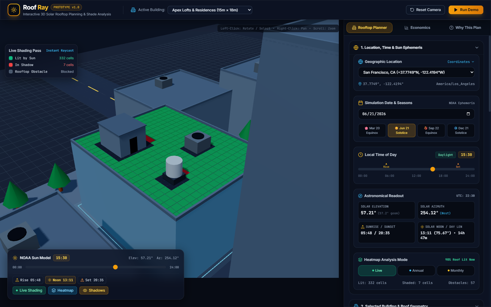
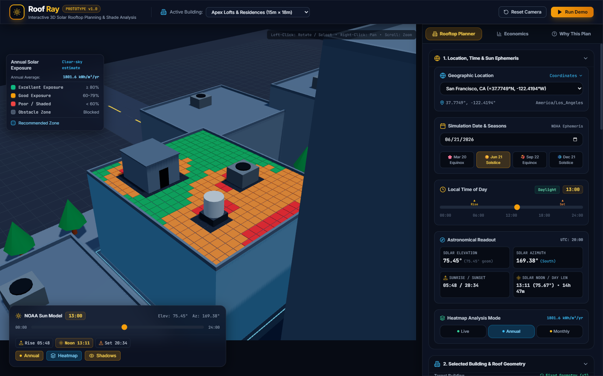
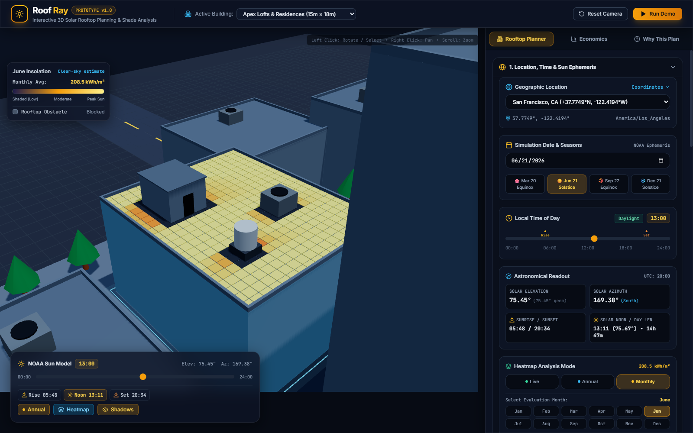
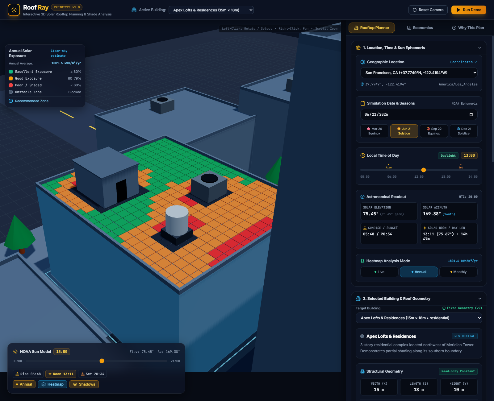
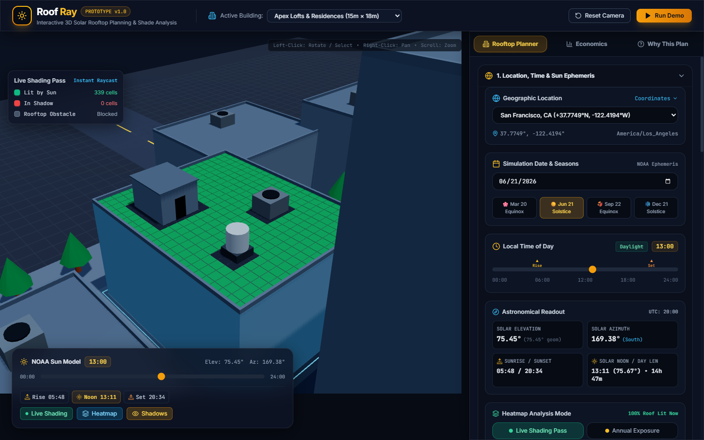
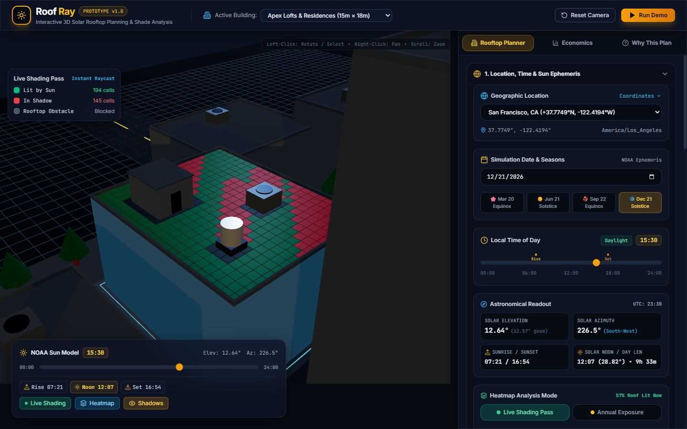

<div align="center">

```
██████╗  ██████╗  ██████╗ ███████╗██████╗  █████╗ ██╗   ██╗
██╔══██╗██╔═══██╗██╔═══██╗██╔════╝██╔══██╗██╔══██╗╚██╗ ██╔╝
██████╔╝██║   ██║██║   ██║█████╗  ██████╔╝███████║ ╚████╔╝ 
██╔══██╗██║   ██║██║   ██║██╔══╝  ██╔══██╗██╔══██║  ╚██╔╝  
██║  ██║╚██████╔╝╚██████╔╝██║     ██║  ██║██║  ██║   ██║   
╚═╝  ╚═╝ ╚═════╝  ╚═════╝ ╚═╝     ╚═╝  ╚═╝╚═╝  ╚═╝   ╚═╝   
```

### **AI-Powered 3D Rooftop Solar Planning, Simulation & Recommendation Platform**
*Deterministic 3D Raycasting • Astronomical Ephemeris • Grounded Gemini AI Advisor • Multi-Currency Economics*

---

[](npm-run-test:all)
[](https://react.dev/)
[](https://threejs.org/)
[](https://www.typescriptlang.org/)
[](https://aistudio.google.com)
[](#8-ai-powered-solar-advisor)
[](#3-solar-irradiance--heatmap-analysis)
[](#10-english-and-bengali-localization)
[](LICENSE)

[**Interactive Solar Studio (`/app`)**](#-running-the-frontend-and-backend) • [**Public Landing Page (`/`)**](#-running-the-frontend-and-backend) • [**Key Features**](#-key-features) • [**Architecture**](#-system-architecture) • [**Documentation**](docs/) • [**Getting Started**](#-installation-and-setup)

</div>

---

## 📖 Table of Contents

1. [Executive Overview & Problem Statement](#-executive-overview--problem-statement)
2. [Key Features](#-key-features)
   - [Interactive 3D Rooftop Visualization](#1-interactive-3d-rooftop-visualization)
   - [Solar Shadow & Sun-Path Simulation](#2-solar-shadow--sun-path-simulation)
   - [Solar Irradiance & Heatmap Analysis](#3-solar-irradiance--heatmap-analysis)
   - [Automated Solar Panel Placement](#4-automated-solar-panel-placement)
   - [Manual Rooftop Panel Placement](#5-manual-rooftop-panel-placement)
   - [Solar Energy Production Estimation](#6-solar-energy-production-estimation)
   - [Financial Analysis, ROI & Payback](#7-financial-analysis-roi--payback)
   - [AI-Powered Solar Advisor](#8-ai-powered-solar-advisor)
   - [Engineering Recommendations & Regulatory Grounding](#9-engineering-recommendations--regulatory-grounding)
   - [English and Bengali Localization](#10-english-and-bengali-localization)
3. [Application Preview & Screenshots](#-application-preview--screenshots)
4. [Technology Stack](#-technology-stack)
5. [System Architecture](#-system-architecture)
6. [Project Directory Structure](#-project-directory-structure)
7. [Installation and Setup](#-installation-and-setup)
8. [Environment Variable Configuration](#-environment-variable-configuration)
9. [Running the Frontend and Backend](#-running-the-frontend-and-backend)
10. [Testing Instructions](#-testing-instructions)
11. [Engineering Assumptions & Limitations](#-engineering-assumptions--limitations)
12. [License & Acknowledgements](#-license--acknowledgements)

---

## ⚡ Executive Overview & Problem Statement

Urban rooftop solar adoption faces significant bottlenecks:
- **Costly Manual Audits:** Physical site inspections require specialized drone equipment, surveying visits, and weeks of engineering back-and-forth.
- **Inaccurate Generic Estimates:** Standard web calculators use synthetic horizontal irradiance curves without calculating real geometric shadows cast by water tanks, stairwells, HVAC chillers, parapets, or adjacent high-rise towers.
- **Complex Regulatory Frameworks:** Navigating net metering guidelines (such as the Bangladesh SREDA 2025 Gazette), transformer capacity limits, sanctioned load caps, and phase-matching requirements is intimidating for residential and commercial property owners.
- **AI Hallucinations in Engineering:** Treating large language models as numerical engines leads to fabricated yields, incorrect payback projections, and ungrounded electrical assertions.

### The RoofRay Solution

**RoofRay** resolves these challenges by strictly decoupling **deterministic 3D physics simulation** from **natural language AI advisory**:

```
┌──────────────────────────────────────────────────────────────────────────────┐
│                              ROOFRAY PLATFORM                                │
├──────────────────────────────────────┬───────────────────────────────────────┤
│    DETERMINISTIC SIMULATION CORE     │          INTELLIGENT ADVISOR          │
│                                      │                                       │
│ • NOAA Ephemeris (±0.1° accuracy)    │ • Lexical BM25 Regulatory RAG         │
│ • 0.8m Grid Line-of-Sight Raycasting │ • SREDA 2025 / BPDB / NREL Corpus     │
│ • Hourly Diurnal Shadow Calculations │ • Google Gemini 3.5 Flash-Lite        │
│ • Multi-Objective Panel Optimization │ • Conversational Chat & Audit Reports │
│ • Dual-Currency (USD/BDT) Economics  │ • Strict Single Source of Truth Rule  │
└──────────────────────────────────────┴───────────────────────────────────────┘
```

1. **Physical Engine as Single Source of Truth:** Astronomical math and line-of-sight raycasting compute exact solar angles, shadow occlusions, panel counts, kWh yields, and cash-flow projections.
2. **Lexical BM25 RAG Grounding:** Verified regulatory documentation from **SREDA**, **BPDB**, **NREL**, and **DoE** is indexed and dynamically retrieved based on geographical context.
3. **Conversational AI Advisory:** Google Gemini synthesizes explainable engineering recommendations, risk analysis, and actionable next steps without inventing calculations or altering verified figures.

---

## 🚀 Key Features

### 1. Interactive 3D Rooftop Visualization
- **WebGL Digital Twin:** Powered by Three.js and `@react-three/fiber`, rendering high-fidelity 3D buildings, rooftop architectural obstacles, and neighboring structures with realistic lighting.
- **Orbit Camera Controls:** Seamless rotation, panning, and zoom with smart boundary constraints, smooth easing, and one-click camera reset.
- **First-Entry Guided Tour:** Interactive spotlight tutorials that introduce beginners to building selection, orbit navigation, and analysis controls.

### 2. Solar Shadow & Sun-Path Simulation
- **NOAA Solar Position Algorithm:** Deterministic solar elevation and azimuth calculated for any latitude, longitude, date, and local minute within $\pm 0.1^\circ$ precision.
- **Astronomical Solstice & Equinox Presets:** One-click navigation to Summer Solstice, Winter Solstice, Spring Equinox, and Autumn Equinox.
- **Diurnal Time Scrubbing:** Dynamic 24-hour sun simulation slider with real-time shadow casting, polar day/night detection, and variable playback speeds ($1\times$, $2\times$, $4\times$).
- **3D Solar Arcs & Compass Rose:** Interactive 3D celestial path arcs across solstices and equinoxes alongside a 3D cardinal North compass rose.

### 3. Solar Irradiance & Heatmap Analysis
- **0.8m Raycast Resolution:** Rooftops are discretized into a high-density $0.8\text{m} \times 0.8\text{m}$ grid for precise obstacle occlusion modeling.
- **Dual Heatmap Modes:**
  - *Live Shading Pass:* Real-time binary line-of-sight shadow testing at the selected sun elevation and azimuth.
  - *Annual Solar Insolation:* 12-month integrated daylight and exposure mapping executed asynchronously via background Web Workers.
- **Monthly Insolation Breakdown:** Interactive 12-month bar chart displaying seasonal variance and peak solar months.
- **NASA POWER Satellite Climatology:** Direct integration with the NASA Langley Research Center POWER API v2.0 for 30-year multi-year all-sky insolation and historical cloud attenuation derating.

### 4. Automated Solar Panel Placement
- **Four Optimization Strategies:**
  - *Balanced (Recommended):* Maximizes energy yield while maintaining budget efficiency and structural setbacks.
  - *Maximum Generation:* Fills all viable, unshaded rooftop space for maximum kWh output.
  - *Lowest CapEx:* Targets only the highest-exposure rooftop hotspots to minimize upfront capital expenditure.
  - *Meet Consumption Demand:* Solves for the exact module count required to offset 100% of the target building's annual electricity consumption.
- **Safety Buffers & Setbacks:** Enforces mandatory $0.8\text{m}$ roof perimeter fire setbacks and $0.5\text{m}$ physical obstacle buffers around HVAC units, water tanks, stairwells, and parapets.

### 5. Manual Rooftop Panel Placement
- **Interactive Manual Layout Studio:** Complete CAD-style rooftop editing interface.
- **Placement & Editing Tools:** Single-panel placement, rectangular zone filling, panel selection, 90° rotation (Portrait/Landscape), deletion, and full Undo/Redo history stacks.
- **Smart Placement Suggestions:** Analyzes annual exposure and obstacle shadows to automatically suggest the most productive unshaded location for the next panel.
- **String Mismatch Detection:** Warns users when adjacent panels have $>20\%$ variance in annual exposure, recommending micro-inverter topology or relocation.

### 6. Solar Energy Production Estimation
- **Per-Panel Production Modeling:** Integrates individual panel wattages, azimuth orientations, tilt angles, and calculated annual exposure scores.
- **Hardware Catalog:** Pre-configured commercial PV module models:
  - High-Efficiency Monocrystalline (400W, 21.5% efficiency)
  - Commercial Bifacial PERC (550W, 22.0% efficiency)
  - Standard Polycrystalline (330W, 17.5% efficiency)
- **Consumption Offset Tracking:** Real-time demand offset percentage and surplus grid export calculation against customizable residential and commercial consumption profiles.

### 7. Financial Analysis, ROI & Payback
- **Dual-Currency Support (USD `$` / BDT `৳`):** Native localized currency formatting (including South Asian numbering: `৳৮,৭৫,০০০`).
- **Comprehensive Financial KPIs:**
  - Turnkey Capital Expenditure (CapEx)
  - First-Year Annual Bill Savings
  - Simple Payback Period (years)
  - 20-Year Net Lifetime Cash-Flow
  - Simple Return on Investment (ROI %)
- **Configurable Tariffs & Policies:** Configurable retail electricity tariffs, turnkey installation rates per kW, base permitting fees, and net-metering export credit ratios.
- **Environmental Decarbonization Accounting:** Annual $\text{CO}_2$ abatement calculation in metric tonnes and tree-planting equivalence, utilizing regional grid emission factors (Bangladesh DoE 2023 grid baseline: $0.620\text{ kg CO}_2/\text{kWh}$; Global IEA baseline: $0.420\text{ kg CO}_2/\text{kWh}$).

### 8. AI-Powered Solar Advisor
- **Conversational Chatbot Interface:** ChatGPT-style conversational assistant specifically tailored for solar engineering.
- **Expandable / Collapsible Chat Workspace:** Resizable interface allowing users to switch between a focused 3D planner view and an expanded reading workspace.
- **Context-Aware Suggested Prompts:** Dynamically generates jurisdiction-relevant follow-up questions based on the active building's location (e.g., San Francisco vs. Dhaka).
- **Collapsible Metric Readouts:** Clean presentation of detailed financial breakdowns, advantages, and risks in structured expandable accordions.

### 9. Engineering Recommendations & Regulatory Grounding
- **BM25 Lexical RAG Architecture:** Queries an indexed regulatory knowledge corpus without hallucinations:
  - *SREDA Net Metering Guidelines 2025:* Up to 100% sanctioned load cap, single-phase and three-phase consumer eligibility, 80% distribution transformer restriction for MV/HT/EHT, and phase-matching mandates.
  - *BPDB Gazette Tariffs 2024:* Slab-based residential and commercial electricity tariff rates.
  - *Grid Interconnection Standards:* IEC 62116 anti-islanding testing, IEC 61727 / IEEE 1547 interconnection, and $\le 2.0\text{s}$ disconnection.
- **Transparent Citations:** Every advisory response includes traceable technical citations with source titles and official reference links.

### 10. English and Bengali Localization
- **Exhaustive Bilingual Parity:** Instant zero-reload language switching between **English** and **বাংলা**.
- **Native Typography:** Integrated Google Font **`Hind Siliguri`** (weights 300–700) for authentic rendering of complex Bengali ligatures (*যুক্তাক্ষর*) and diacritics.
- **Consistent Terminology:** Accurately translates specialized engineering terms (e.g., Solar Potential → *সৌরবিদ্যুৎ উৎপাদনের সম্ভাবনা*, Net Metering → *নেট মিটারিং*, CapEx → *প্রাথমিক স্থাপন ব্যয়*, Payback Period → *বিনিয়োগ ফেরতের সময়*) while preserving standard units and acronyms (SREDA, BPDB, kW, kWh, BDT, USD).

---

## 📸 Application Preview & Screenshots

| Live Diurnal Shading & Shadow Raycasting | Annual Cumulative Exposure Heatmap |
| :---: | :---: |
|  |  |

| Monthly Solar Insolation Distribution | Solar Potential & NASA POWER Climatology |
| :---: | :---: |
|  |  |

| Summer Solstice High-Sun Trajectory | Winter Solstice Low-Sun Shadow Projection |
| :---: | :---: |
|  |  |

---

## 🛠️ Technology Stack

| Layer | Technology | Purpose |
|---|---|---|
| **Frontend Framework** | **React 19** (`react`, `react-dom`) | Modern component architecture, hooks, and reactive UI state |
| **3D Engine** | **Three.js** (`three`, `@react-three/fiber`, `@react-three/drei`) | WebGL scene rendering, 3D building geometry, directional lighting, and shadows |
| **Language & Typing** | **TypeScript 5.7** | Strict compile-time type safety across simulation models, API contracts, and i18n |
| **State Management** | **Zustand 5** | High-performance, lightweight store for solar parameters, 3D scene state, and layout history |
| **Styling & Design** | **Tailwind CSS 3.4** | Utility-first responsive design, dark slate theme, custom glassmorphism panels |
| **Typography** | **Hind Siliguri** & **Inter** | Crisp Latin and native Bengali script rendering |
| **Icons** | **Lucide React** | Scalable, clean vector iconography |
| **Build Tool** | **Vite 6** | Ultra-fast development bundling, hot module replacement (HMR), and production chunking |
| **Runtime & Server** | **Node.js** (v18+) & **TypeScript Execution (`tsx`)** | Production HTTP server, static asset distribution, and backend API routing |
| **AI Synthesis** | **Google Gemini 3.5 Flash-Lite** (`@google/genai`) | Cost-effective, low-latency, physics-grounded engineering advisory synthesis |
| **Information Retrieval**| **BM25 Lexical RAG** | Deterministic term-frequency ranking over verified regulatory standards |
| **Satellite Climatology**| **NASA POWER API v2.0** | 30-year historical solar irradiance and cloud cover derating factors |

---

## 🏛️ System Architecture

```
                                  USER BROWSER
    ┌────────────────────────────────────────────────────────────────────────┐
    │  Public Landing Page (/)  ◄─── SPA Router ───►  Solar Studio (/app)    │
    │                                                                        │
    │  ┌─────────────────────────┐             ┌──────────────────────────┐  │
    │  │  Three.js 3D Viewport   │             │   Control & AI Panels    │  │
    │  │  • Digital Twin Scene   │             │   • Manual Layout CAD    │  │
    │  │  • Real-Time Shadows    │◄───────────►│   • Economics & Tariffs  │  │
    │  │  • Orbit Controls       │             │   • Guided Tutorials     │  │
    │  └────────────▲────────────┘             │   • Conversational Chat  │  │
    │               │                          └────────────▲─────────────┘  │
    │  ┌────────────┴───────────────────────────────────────┴─────────────┐  │
    │  │                   Zustand Solar State Store                      │  │
    │  │  • Buildings  • NOAA Ephemeris  • Heatmap Cells  • Panels Array  │  │
    │  └────────────────────────────────▲─────────────────────────────────┘  │
    └───────────────────────────────────┼────────────────────────────────────┘
                                        │ (Asynchronous Web Worker & Fetch)
                                        ▼
    ┌────────────────────────────────────────────────────────────────────────┐
    │                      ROOFRAY SERVER & PROXY ENGINE                     │
    │                                                                        │
    │  • Path Traversal Security Defense                                     │
    │  • Strict CORS Origin Whitelisting                                     │
    │  • Request Body & Parameter Bounds Validation                          │
    │  • Daily Rate Limiting (500 req/day quota)                             │
    │                                                                        │
    │  ┌────────────────────────┐             ┌───────────────────────────┐  │
    │  │   BM25 Lexical RAG     │             │    Gemini API Gateway     │  │
    │  │   • SREDA 2025 Gazette │             │    • Header Secret Auth   │  │
    │  │   • BPDB Tariffs 2024  │────────────►│    • System Instructions  │  │
    │  │   • IEEE/IEC Standards │             │    • Structured JSON Mode │  │
    │  └────────────────────────┘             └─────────────▲─────────────┘  │
    └───────────────────────────────────────────────────────┼────────────────┘
                                                            ▼
                                                Google Gemini 3.5 Flash-Lite
```

---

## 📁 Project Directory Structure

```
RoofRay/
├── docs/                           # Comprehensive technical & competition documentation
│   ├── ai-architecture.md          # Physics grounding & BM25 retrieval pipeline
│   ├── business-model.md           # Market viability, unit economics & monetization
│   ├── data-flow.md                # End-to-end data pipelines & state lifecycles
│   ├── data-sources.md             # Scientific registry (NOAA, SREDA, NASA, BPDB)
│   ├── kpi-and-validation.md       # Validation criteria & test assertions
│   ├── privacy-and-security.md     # Server secret isolation & threat modeling
│   ├── problem-definition.md       # Target personas, pain points & value propositions
│   ├── product-overview.md         # Complete functional feature matrix
│   ├── responsible-ai.md           # Explainability, guardrails & ethical AI standards
│   ├── scalability-roadmap.md      # Future GIS, LiDAR & Wasm scaling horizons
│   ├── submission-checklist.md     # Competition readiness audit matrix
│   ├── system-architecture.md      # High-level architecture & subsystems
│   ├── team-roles.md               # Team role assignment matrix
│   └── three-minute-pitch.md       # Competition pitch script
├── public/                         # Static assets
│   └── solar-favicon.svg           # RoofRay brand vector favicon
├── scripts/                        # Automated verification & test suites
│   ├── browserTest.js              # Headless Chrome E2E browser automation (70 tests)
│   ├── testGeminiConnection.ts     # Live Gemini API connectivity verification
│   └── validateAll.js              # Production server & security controls suite (57 tests)
├── server/                         # Production backend server
│   └── server.ts                   # Standalone Node.js server with SPA routing & AI proxy
├── src/                            # Application source code
│   ├── calculations/               # Deterministic mathematical models
│   │   ├── economics.ts            # CapEx, bill savings, payback, and ROI calculations
│   │   ├── geometry.ts             # 3D bounding boxes, SAT collisions, and raycasting
│   │   ├── layoutOptimizer.ts      # Multi-objective automated panel placement
│   │   ├── recommendation.ts       # Deterministic narrative generator (EN/BN)
│   │   ├── solarAnalysis.ts        # Hourly and annual solar exposure integration
│   │   ├── sunPosition.ts          # NOAA astronomical solar position ephemeris
│   │   └── analysis.worker.ts      # Multi-threaded Web Worker for annual heatmap
│   ├── components/                 # React UI component hierarchy
│   │   ├── layout/                 # Structural containers (Header, ViewportControls)
│   │   ├── panels/                 # Modular sidebar cards (Advisor, Building, Economics, etc.)
│   │   ├── scene/                  # Three.js 3D canvas, camera controls & lighting
│   │   └── ui/                     # Reusable UI primitives (RoofRayLogo, Modal, Toast)
│   ├── data/                       # Built-in archetypes and catalogs
│   │   ├── buildings.ts            # Fixed building geometry presets (frozen objects)
│   │   └── panelTypes.ts           # Commercial PV module hardware specifications
│   ├── i18n/                       # Internationalization & translations
│   │   ├── translations.ts         # Centralized bilingual dictionaries (EN & BN)
│   │   └── useLanguage.ts          # React language context and toggle hook
│   ├── rag/                        # Lexical Retrieval-Augmented Generation
│   │   ├── knowledge/              # Verified regulatory and technical knowledge corpus
│   │   └── retrievalEngine.ts      # BM25 term weighting & retrieval ranking
│   ├── router/                     # Lightweight SPA client router
│   │   └── Router.tsx              # Route provider for `/` and `/app`
│   ├── server/                     # Backend advisory service modules
│   │   └── advisorService.ts       # Gemini API caller, prompt builder & schema validation
│   ├── services/                   # External API clients
│   │   └── solarResourceService.ts # NASA POWER satellite climatology client
│   ├── store/                      # Zustand centralized application state
│   │   ├── useGuidanceStore.ts     # Tutorial progress & modal state
│   │   └── useSolarStore.ts        # Solar parameters, active building, and array layouts
│   ├── tests/                      # Deterministic unit tests
│   │   └── calculations.test.ts    # Comprehensive physics and math test suite (334 tests)
│   ├── utils/                      # Formatting & mathematical helpers
│   │   └── currency.ts             # Multi-currency formatting (USD and BDT)
│   ├── App.tsx                     # Main interactive application root
│   ├── index.css                   # Global Tailwind styles & font declarations
│   └── main.tsx                    # React DOM entry point
├── .env.example                    # Environment template with configuration instructions
├── .gitignore                      # Git exclusion rules (isolates secrets and artifacts)
├── index.html                      # HTML5 template with fonts & metadata
├── LICENSE                         # Open-source MIT License
├── package.json                    # Project metadata, dependencies & scripts
├── tailwind.config.js              # Tailwind styling & typography configuration
├── tsconfig.json                   # TypeScript compiler options
└── vite.config.ts                  # Vite bundler configuration & dev API proxy
```

---

## 💻 Installation and Setup

### 1. Prerequisites
- **Node.js:** v18.0.0 or later (v20+ LTS recommended)
- **Package Manager:** `npm` (included with Node.js)

### 2. Clone Repository
```bash
git clone https://github.com/jawaid687/RoofRay.git
cd RoofRay
```

### 3. Install Dependencies
```bash
npm install
```

---

## 🔐 Environment Variable Configuration

RoofRay keeps sensitive credentials isolated on the server. Copy the example configuration:

```bash
cp .env.example .env
```

Open `.env` in your text editor:

```env
# Server-Side Gemini API Key (Required for live AI Solar Advisor synthesis)
# Obtain a free or commercial key from Google AI Studio: https://aistudio.google.com/
# SECURITY NOTICE: Never prefix with VITE_ or expose this secret to frontend code.
GEMINI_API_KEY=your_actual_gemini_api_key_here

# Gemini Model Selection (Defaults to gemini-3.5-flash-lite)
GEMINI_MODEL=gemini-3.5-flash-lite

# Standalone Production Server Port (Default: 3001)
PORT=3001

# Application Environment
NODE_ENV=development
```

> [!NOTE]
> RoofRay works completely without a Gemini API key for all 3D physics raycasting, solar ephemeris, manual layout editing, financial modeling, and exportable reports. A key is only required for live conversational synthesis in the AI Solar Advisor.

---

## 🚦 Running the Frontend and Backend

### Option A: Development Server (Recommended for Development)
```bash
npm run dev
```
- Starts Vite on [http://localhost:3000](http://localhost:3000).
- Includes hot module replacement (HMR) and transparent Vite proxy middleware for `/api/ai/*` requests.
- Navigate to:
  - Landing Page: `http://localhost:3000/`
  - 3D Solar Studio: `http://localhost:3000/app`

### Option B: Standalone Production Server
```bash
# 1. Compile TypeScript and build production assets
npm run build

# 2. Start the standalone Node.js production server
npm start
# (or: npm run server)
```
- Starts on [http://localhost:3001](http://localhost:3001) (or `process.env.PORT`).
- Serves optimized static assets from `dist/` with SPA routing and genuine `/api/ai/*` endpoints.

---

## 🧪 Testing Instructions

RoofRay maintains an extensive automated test pipeline covering physics, unit calculations, API security, and browser interactions:

```bash
# Run the complete test pipeline (Build + Physics + Server + Browser E2E)
npm run test:all
```

You can also run individual test suites independently:

```bash
# 1. Deterministic Astronomical, Physics & Calculation Unit Tests (334 tests)
npm test

# 2. Production Server, Security & Regulatory RAG Integration Tests (57 tests)
npm run test:integration

# 3. Headless Chrome E2E Browser Automation Tests (70 tests)
npm run test:browser

# 4. Live Gemini API Connectivity Verification (Requires GEMINI_API_KEY)
npm run test:gemini
```

### Verified Test Suite Breakdown (461 Total Assertions):
- **NOAA Solar Position & Ephemeris (30 assertions):** Solar noon, solstices, equinoxes, southern azimuth in Sydney, polar day/night in Tromsø within $\pm 0.1^\circ$.
- **Fixed Building Geometry & Shading (14 assertions):** Deep immutability, line-of-sight raycasting, and diurnal shadow ratios.
- **Annual Solar Exposure (12 assertions):** 12-month integration, Web Worker cancellation, and cache hit latencies.
- **Manual Layout Studio (32 assertions):** 0.8m perimeter setback, 0.5m obstacle buffers, SAT collision tests, undo/redo state stacks.
- **Milestone & Performance Checks (13 assertions):** Celestial arc geometries, vector conventions, and 60 FPS render budgets.
- **Bangladesh Localization (50 assertions):** Verified geographical coordinates for all 8 administrative divisions, BDT currency formatting, and Bengali translations.
- **Financial & Decarbonization Models (21 assertions):** Dual-currency calculations, missing-tariff guards (`paybackYears: null`), and verified grid emission factors.
- **Lexical RAG Engine (13 assertions):** BM25 term weighting, SREDA 2025 net-metering chunk ranking, and authentic citation links.
- **Deterministic NASA POWER Climatology (15 assertions):** Offline fixtures, physical invariants ($\text{ClearSky} \ge \text{AllSky}$), and missing-irradiance rejection.
- **AI Advisor Schema & Security Guardrails (106 assertions):** Latitude/longitude bounds, wattage validation, response schema enforcement, and credential leakage protection.
- **Deterministic Recommendations (28 assertions):** Per-panel yield summation invariant, optimization mode correctness, and narrative generation.
- **Production Server & Security Controls (57 assertions):** Path traversal defenses, whitelisted CORS, payload size limits ($\le 100\text{KB}$), and rate limiting.
- **Headless Chrome Browser E2E Suite (70 assertions):** Real Chrome DevTools Protocol (CDP) verification of DOM hydration, vertical scrolling, bilingual toggling, Three.js canvas interaction, camera guidance, spotlight tutorials, and conversational chat.

---

## ⚖️ Engineering Assumptions & Limitations

1. **Deterministic Clear-Sky Raycasting:** Solar exposure scores represent deterministic geometric line-of-sight calculations using NOAA ephemeris. While highly accurate for physical shading from parapets, water tanks, and towers, actual solar generation is influenced by atmospheric turbidity, cloud cover, and ambient temperature derating.
2. **Satellite Climatology Integration:** Weather-informed estimates incorporate historical multi-year satellite data from the NASA POWER database. These figures represent historical statistical averages rather than predictive real-time weather forecasts.
3. **Financial Projections:** Payback periods and lifetime savings are based on annualized flat-tariff models and user-configured electricity rates. Projections do not model utility time-of-use (TOU) tier switching, loan financing interest, or inflation indexing.
4. **Professional Structural Verification:** RoofRay provides preliminary engineering feasibility estimates. Formal solar installations require certified structural roof load assessments, electrical distribution inspections, and formal utility net-metering interconnection approval from relevant regulatory authorities (e.g., BPDB, DESCO, DPDC, PG&E) prior to hardware procurement.

---

## 📄 License & Acknowledgements

### License
This project is open-source software licensed under the [MIT License](LICENSE).

### Scientific & Regulatory Acknowledgements
- **NOAA Earth System Research Laboratories (ESRL):** Solar Position and Ephemeris Algorithms.
- **NASA Langley Research Center (LaRC):** Prediction of Worldwide Energy Resources (POWER) Climatology API.
- **Sustainable and Renewable Energy Development Authority (SREDA):** Net Metering Guidelines 2025.
- **Bangladesh Power Development Board (BPDB):** Gazette Tariff Schedules.
- **National Renewable Energy Laboratory (NREL):** Photovoltaic Fundamentals and System Sizing Research.
- **Department of Environment (DoE), Bangladesh:** National Grid Emission Factor Studies.
