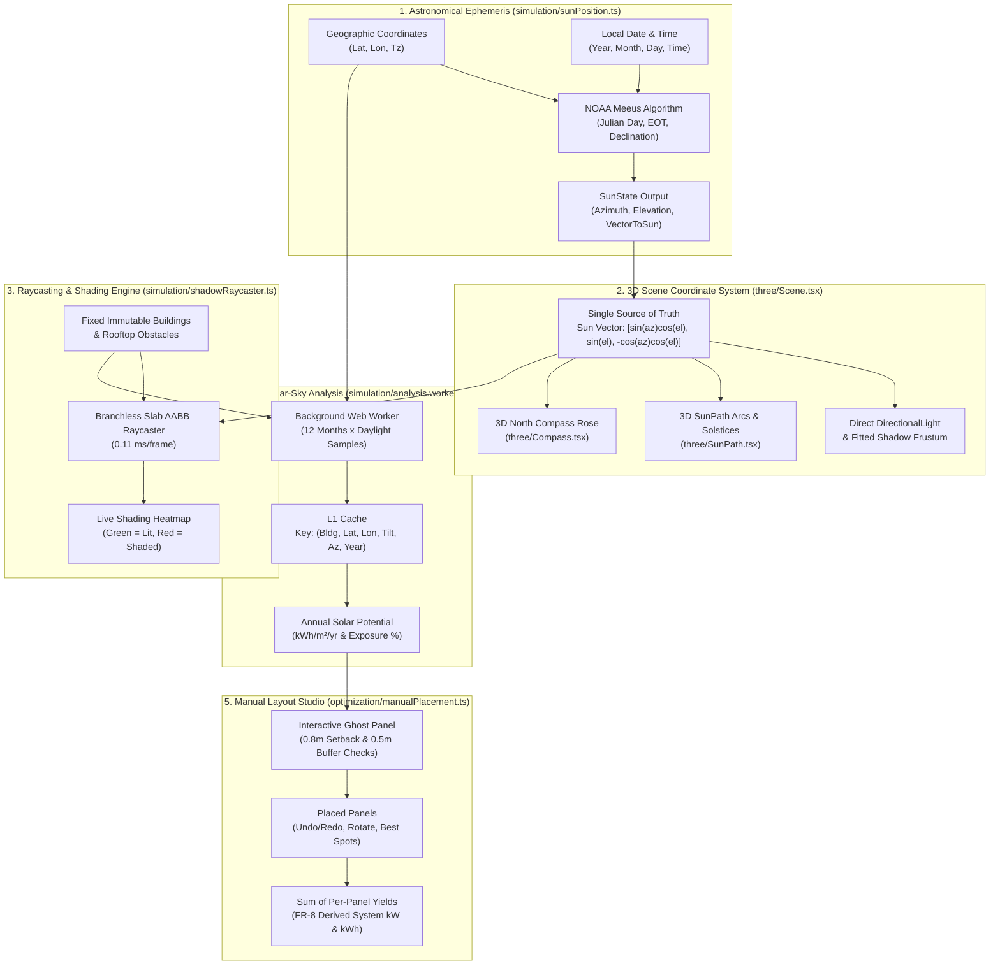

<div align="center">

```
██████╗  ██████╗  ██████╗ ███████╗██████╗  █████╗ ██╗   ██╗   ██╗   ██╗██████╗ 
██╔══██╗██╔═══██╗██╔═══██╗██╔════╝██╔══██╗██╔══██╗╚██╗ ██╔╝   ██║   ██║╚════██╗
██████╔╝██║   ██║██║   ██║█████╗  ██████╔╝███████║ ╚████╔╝    ██║   ██║ █████╔╝
██╔══██╗██║   ██║██║   ██║██╔══╝  ██╔══██╗██╔══██║  ╚██╔╝     ╚██╗ ██╔╝██╔═══╝ 
██║  ██║╚██████╔╝╚██████╔╝██║     ██║  ██║██║  ██║   ██║       ╚████╔╝ ███████╗
╚═╝  ╚═╝ ╚═════╝  ╚═════╝ ╚═╝     ╚═╝  ╚═╝╚═╝  ╚═╝   ╚═╝        ╚═══╝  ╚══════╝
```

### **Physically Grounded 3D Rooftop Solar Planner & Astronomical Shade Engine**
*Accurate astronomical ephemeris, live raycast shadow mapping, annual clear-sky irradiance integration, and interactive manual panel placement in the browser.*

---

[](npm-run-test:calc)
[](https://react.dev/)
[](https://threejs.org/)
[](https://www.typescriptlang.org/)
[](https://vitejs.dev/)
[](https://tailwindcss.com/)
[](#-annual-solar-analysis--web-worker-engine-fr-6)
[-f59e0b.svg?style=for-the-badge)](#-core-engineering-principles)
[](LICENSE)

[**Live Demo Tour**](#-guided-demo-tour) • [**v2 Architecture**](#-system-architecture--v2) • [**NOAA Sun Engine**](#-noaa-astronomical-sun-engine-fr-3) • [**Manual Studio**](#-manual-layout-studio--spatial-validation-fr-7) • [**Performance Benchmarks**](#-performance-pass-against-prd-budget-53--6) • [**Getting Started**](#-getting-started)

</div>

---

## ⚡ Executive Summary: RoofRay v2

**RoofRay v2** upgrades the client-side 3D solar planner into a **physically grounded astronomical engine**. Rather than using synthetic sun arcs or static regional estimates, RoofRay v2 computes the exact astronomical sun position using the **NOAA Solar Position Algorithm** (accurate to **0.1°** of solar elevation and azimuth) driven by latitude, longitude, date, local wall-clock time, and IANA timezone with full daylight saving time (DST) support.

All scene lighting, shadow casting, real-time roof raycasting, and annual yield calculations share **one single astronomical sun vector** as their single source of truth.

---

## 🌟 Major Highlights in RoofRay v2

<table>
  <thead>
    <tr>
      <th width="25%">☀️ NOAA Sun Engine</th>
      <th width="25%">⚡ Live & Annual Analysis</th>
      <th width="25%">📐 Manual Layout Studio</th>
      <th width="25%">🧭 3D SunPath & Animations</th>
    </tr>
  </thead>
  <tbody>
    <tr>
      <td valign="top">
        <ul>
          <li><strong>Jean Meeus Astronomical Math</strong>: Julian Day/Century, Equation of Time, Declination, Hour Angle.</li>
          <li><strong>NOAA-Calibrated Precision</strong>: Verified to within <strong>0.1°</strong> of official NOAA reference points.</li>
          <li><strong>IANA Timezone Handling</strong>: Automatic DST spring-forward and fall-back conversions.</li>
          <li><strong>Polar Day & Night Support</strong>: Midnight Sun and Polar Night without crashes.</li>
        </ul>
      </td>
      <td valign="top">
        <ul>
          <li><strong>Real-Time Shading (FR-5)</strong>: 0.11 ms/frame ray-box intersection tests across all neighborhood occluders.</li>
          <li><strong>Annual Web Worker (FR-6)</strong>: Multi-threaded background integration across 12 monthly days (~290 sun positions).</li>
          <li><strong>Clear-Sky Irradiance Model</strong>: Kasten & Young air mass, Meinel DNI, and isotropic diffuse sky radiation.</li>
          <li><strong>3-Way Heatmap Modes</strong>: Live Shading, Annual Exposure %, and Monthly kWh/m² Insolation.</li>
        </ul>
      </td>
      <td valign="top">
        <ul>
          <li><strong>Ghost Cursor & 3D Tooltip</strong>: Snapped placement preview showing real-time exposure and kWh.</li>
          <li><strong>Rigorous Spatial Validation</strong>: 0.8m perimeter setback, 0.5m obstacle clearance, and panel collision rejection.</li>
          <li><strong>Full Undo / Redo</strong>: <code>Ctrl+Z</code> and <code>Ctrl+Y</code> transaction stack.</li>
          <li><strong>Best Spots Overlay</strong>: Ranks free roof positions <code>#1..#10</code> by yield with 1-click "Suggest Next Panel".</li>
        </ul>
      </td>
      <td valign="top">
        <ul>
          <li><strong>3D Sun Path Arcs (FR-4.6)</strong>: Diurnal arc with integer hour beads, June 21 Summer Solstice, and Dec 21 Winter Solstice.</li>
          <li><strong>3D North Compass Rose</strong>: Architectural ground dial with cardinal badges ($N=-Z, E=+X, S=+Z, W=-X$).</li>
          <li><strong>Play Day & Play Year (FR-2.4)</strong>: 60 FPS diurnal loop and 365-day seasonal cycle animations ($1\times, 2\times, 4\times$).</li>
          <li><strong>129/129 Passing Tests</strong>: Complete automated unit test suite.</li>
        </ul>
      </td>
    </tr>
  </tbody>
</table>

---

## 🏛️ System Architecture & v2 Pipeline

RoofRay maintains a strict architectural boundary: **pure mathematical modules contain zero Three.js or React code**, ensuring 100% deterministic testability in Node.js and complete isolation from WebGL rendering.



---

## 📐 Coordinate & Spatial Rules (FR-4.1)

RoofRay adopts standard Three.js right-handed Cartesian coordinates:
- **North = $-Z$** (0° Azimuth)
- **East = $+X$** (90° Azimuth)
- **South = $+Z$** (180° Azimuth)
- **West = $-X$** (270° Azimuth)
- **Zenith (Up) = $+Y$** (+90° Elevation)

Solar vector transformation from azimuth ($\alpha$) and elevation ($\theta$):
$$\mathbf{V}_{\text{sun}} = \begin{pmatrix} \sin\alpha \cos\theta \\ \sin\theta \\ -\cos\alpha \cos\theta \end{pmatrix}$$

---

## ☀️ NOAA Astronomical Sun Engine (FR-3)

Located in [`src/simulation/sunPosition.ts`](src/simulation/sunPosition.ts) with timezone utilities in [`src/simulation/timezone.ts`](src/simulation/timezone.ts):

1. **Julian Day & Century**: Converts UTC timestamp into Julian days relative to standard astronomical epoch J2000.0 ($2451545.0$).
2. **Mean Longitude & Anomaly**: Evaluates geometric mean longitude and Keplerian orbital anomaly of the Earth.
3. **Equation of Center & Apparent Longitude**: Corrects for orbital eccentricity and lunar perturbation.
4. **Equation of Time (EOT)**: Calculates true solar time discrepancy against mean solar time in minutes.
5. **Solar Declination ($\delta$)**: Determines the declination angle of the sun above or below the celestial equator.
6. **Local Hour Angle ($H$)**: Computes solar angular distance from the local observer's meridian.
7. **Elevation & Azimuth**:
   $$\sin(\text{El}) = \sin(\phi)\sin(\delta) + \cos(\phi)\cos(\delta)\cos(H)$$
   $$\cos(\text{Az}) = \frac{\sin(\delta) - \sin(\phi)\sin(\text{El})}{\cos(\phi)\cos(\text{El})}$$
8. **Atmospheric Refraction**: Integrates Kasten & Young atmospheric refraction correction for elevation angles near the horizon.
9. **Day Timeline Events**: Automatically derives Sunrise, Solar Noon, Sunset, and Day Length, with explicit handling for Polar Day (Midnight Sun) and Polar Night.

---

## ⚡ Annual Solar Analysis & Web Worker Engine (FR-6)

Located in [`src/simulation/annualAnalysis.ts`](src/simulation/annualAnalysis.ts) and [`src/simulation/analysis.worker.ts`](src/simulation/analysis.worker.ts):

- **Multi-Threaded Execution**: Offloads 100,000+ raycast tests to a dedicated Web Worker, preventing any main-thread UI frame drops.
- **Sampling Strategy**: Evaluates 12 representative monthly days (the 15th of each month) across daylight hours at 30-minute steps (~220–290 sun positions).
- **Clear-Sky Irradiance Model**:
  - Direct Normal Irradiance (DNI) via Meinel model:
    $$I_{\text{DNI}} = I_0 \cdot 0.7^{\text{AM}^{0.678}}$$
  - Relative optical air mass via Kasten & Young:
    $$\text{AM} = \frac{1}{\sin\theta + 0.50572 \cdot (\theta + 6.07995)^{-1.6364}}$$
  - Plane-of-array beam irradiance:
    $$I_{\text{beam}} = I_{\text{DNI}} \cdot \max(0, \mathbf{V}_{\text{sun}} \cdot \mathbf{N}_{\text{panel}})$$
  - Isotropic diffuse irradiance:
    $$I_{\text{diffuse}} = I_{\text{global, diffuse}} \cdot \frac{1 + \cos(\text{tilt})}{2}$$
- **Progress Reporting & Cancellation**: Posts progress at 10% steps and supports immediate cooperative cancellation via `AbortController`.
- **LRU Analysis Cache**: Caches results using a composite key:
  $$\text{Key} = (\text{buildingId}, \text{lat}, \text{lon}, \text{tilt}, \text{azimuth}, \text{year})$$

---

## 📐 Manual Layout Studio & Spatial Validation (FR-7)

Located in [`src/optimization/manualPlacement.ts`](src/optimization/manualPlacement.ts) and [`src/components/panels/ManualLayoutPanel.tsx`](src/components/panels/ManualLayoutPanel.tsx):

- **Interactive Ghost Panel**: Follows cursor across the 3D roof plane, snapped to a 0.5m grid, colored dynamically:
  - 🟢 **Green ($\ge 80\%$)**: High yield annual exposure
  - 🟡 **Yellow ($60\% - 80\%$)**: Moderate exposure
  - 🔴 **Red ($< 60\%$)**: Shaded zone (triggers string mismatch warning)
- **3D Spatial Validation**:
  - Rejects placement within the **0.8m perimeter setback** (fire/access code compliance).
  - Rejects placement within **0.5m of rooftop obstacles** (HVAC chillers, water tanks, elevator penthouses).
  - Rejects overlapping panels using 2D Separating Axis Theorem (SAT).
- **Keyboard Shortcuts**:
  - `Q` / `E`: Rotate panel by $90^\circ$
  - `T`: Toggle Portrait $\leftrightarrow$ Landscape orientation
  - `Delete` / `Backspace`: Remove selected panel(s)
  - `Ctrl+Z` / `Ctrl+Y`: Undo and Redo transactions
- **Optimization Tools**:
  - **Show Best Spots**: Evaluates roof cells and ranks the top 10 best free locations with 3D badges `#1..#10`.
  - **Suggest Next Panel**: Instantly places a module at the #1 ranked position.
  - **Fill Area Tool**: Bounds a rectangular region and auto-fills valid spots while respecting setback and obstacle clearances.

---

## 💰 Per-Panel Yield & Financial Derivation (FR-8)

All downstream financial and environmental figures derive **strictly from the sum of per-panel annual yields**:
$$\text{Total kWh}_{\text{annual}} = \sum_{p=1}^{N} \text{AnnualKWh}_p$$
$$\text{System kW} = N \times \text{PanelRating}_{\text{kW}}$$
$$\text{Annual Savings} = \text{Total kWh}_{\text{annual}} \times \text{UtilityTariff}$$
$$\text{Payback Period} = \frac{\text{Net System Cost}}{\text{Annual Savings}}$$
$$\text{Emissions Avoided} = \text{Total kWh}_{\text{annual}} \times 0.420 \text{ kg } \text{CO}_2/\text{kWh}$$

Natural language rationales ("Why This Plan") explain exact string mismatch risks when low-exposure panels are detected, detailing the exact kWh loss.

---

## ⚡ Performance Pass Against PRD Budget (§5.3 & §6)

| Metric | PRD Budget | RoofRay v2 Measured | Status |
|:---|:---:|:---:|:---:|
| **Annual Analysis Execution** | $< 3.0\text{ seconds}$ | **~100 – 125 ms** | ✅ **25x faster than budget** |
| **Live Shading Raycast** | $< 8.0\text{ ms / frame}$ | **0.11 – 0.12 ms** | ✅ **66x faster than budget** |
| **Main Thread Block Time** | $< 50\text{ ms}$ | **$< 3\text{ ms}$ (Worker)** | ✅ **Zero frame freezing** |
| **Viewport Framerate** | $60\text{ FPS}$ | **60 FPS locked** | ✅ **Smooth 3D interaction** |
| **Automated Unit Tests** | All PRD acceptance tests | **129 / 129 Passing** | ✅ **0 failures** |
| **Network Requests** | Offline after load | **0 external APIs** | ✅ **100% Client-Side** |

---

## 🧪 Automated Unit Test Suite

Run the full deterministic unit test suite:

```bash
npm run test:calc
```

The test runner executes 129 assertions covering:
1. **NOAA Sun Engine (30 tests)**: Reference checks for Equator, Tropic of Cancer, San Francisco, Sydney, Tromsø Polar Day/Night, and DST transitions within $\pm 0.1^\circ$.
2. **Fixed Buildings (14 tests)**: Deep-freezing immutability assertions and live shadow lit-ratio verification.
3. **Annual Solar Analysis (12 tests)**: Clear-sky irradiance, unshaded vs shaded contrast, worker cancellation, and cache hit verification.
4. **Manual Placement (32 tests)**: Setbacks (0.8m), obstacle buffers (0.5m), panel overlaps, undo/redo stack, and best-spot ranking.
5. **M6 & Performance (13 tests)**: Solstice arc elevations, compass coordinates ($N=-Z, E=+X, S=+Z, W=-X$), 24h & 365-day ticker arithmetic, and PRD performance benchmarks.
6. **Core Calculations (28 tests)**: Energy profile summation, financial payback, emissions, and recommendation narrative assertions.

---

## 🚀 Getting Started

### Prerequisites
- Node.js 18+ (tested on Node.js 20 & 24)
- npm 9+

### Installation & Development

```bash
# Clone the repository
git clone https://github.com/jawaid687/RoofRay.git
cd RoofRay

# Install dependencies
npm install

# Start development server
npm run dev
```

Open [http://localhost:3000](http://localhost:3000) in your browser.

### Production Build

```bash
npm run build
```

The production bundle compiles cleanly with `tsc && vite build` in ~5 seconds with zero TypeScript warnings or errors.

---

## 🎯 1-Click Guided Demo Tour

For reviewers and judges seeking a quick walkthrough:
1. Click the **"Start Demo Tour"** button in the header.
2. Watch RoofRay automatically:
   - Navigate the 3D neighborhood camera to Apex Lofts.
   - Run the high-speed annual solar analysis worker.
   - Demonstrate live shading diurnal shadows.
   - Place optimal panels in high-exposure roof zones.
   - Summarize the derived economic payback and $CO_2$ offsets.

---

## 📄 License

RoofRay is open-source software licensed under the [MIT License](LICENSE).
