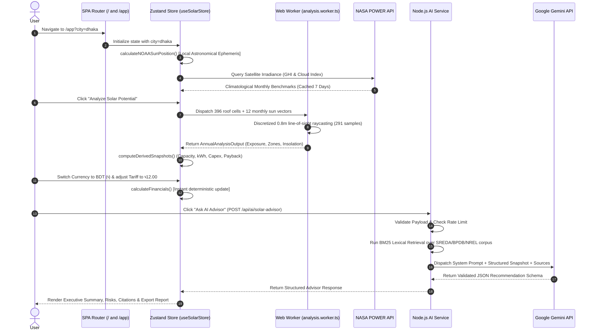

# RoofRay V3 — Data Flow & State Lifecycles

**Track:** International AI Builders Congress 2026 — Idea to Unicorn  
**Topic:** End-to-End Data Pipeline, Transformation Lifecycles, and External APIs  

---

## 1. End-to-End Data Pipeline Flowchart

---

## 2. Core Data Transformation Stages

### Stage 1: Location & Astronomical Ephemeris
- **Inputs:** `latitude`, `longitude`, `year`, `month`, `day`, `timeDecimal`, `timezone`.
- **Transformation:** NOAA solar coordinates algorithm converts wall-clock local time to UTC, computes Julian century, sun declination $\delta$, and hour angle $\omega$, outputting a normalized 3D sun position vector in Three.js coordinates:
  $$\text{Vector}_{\text{sun}} = [\sin(\alpha) \cos(\theta), \sin(\theta), \cos(\alpha) \cos(\theta)]$$
  where $\alpha$ is Azimuth from North (-Z) and $\theta$ is Elevation above the horizon.

### Stage 2: 3D Roof Discretization & Raycasting
- **Inputs:** Target building dimensions ($W \times L$), 3D positions of all neighbor buildings, rooftop obstacles ($x, z, w, l, h$).
- **Transformation:** Generates 396 regular grid cells (0.8m × 0.8m). A ray is projected from cell center to the sun vector. If ray intersects any obstacle box or building mesh, the cell is marked shaded (`false`); otherwise lit (`true`).
- **Annual Analysis:** Iterates across 12 calendar months and 5 diurnal sample hours (8:00, 10:00, 12:00, 14:00, 16:00). Computes cell exposure score $E \in [0.0, 1.0]$.

### Stage 3: Energy Generation Estimation
- **Formula:** Aggregates individual module yields derived from per-cell exposure:
  $$\text{Annual kWh} = \sum_{p \in \text{Panels}} \left( \frac{\text{Wattage}_p}{1000} \times \text{PSH} \times 365 \times \text{PR} \times E_p \right)$$
  - $\text{PSH} = 4.6$ peak sun hours/day (temperate/subtropical sunbelt baseline)
  - $\text{PR} = 0.82$ (inverter, wiring, soiling, and thermal efficiency ratio)
  - $E_p = \text{Average exposure score of cells covered by panel } p$

### Stage 4: Financial & Environmental Derived Metrics
- **Capex:** $\text{Base Permitting Fee} + (\text{Installed kW} \times \text{Cost/kW})$
- **Annual Savings:**
  $$\text{Savings} = (\text{Self-Consumed kWh} \times \text{Tariff}) + (\text{Surplus kWh} \times 0.5 \times \text{Tariff})$$
- **Payback:** $\frac{\text{Total Capex}}{\text{Annual Savings}}$ (guarded: returns `null` if tariff $\le 0$).
- **Carbon Offset:** $\text{Annual kWh} \times \text{Grid Emission Factor}$ ($0.637\text{ kg CO}_2\text{/kWh}$ for Bangladesh, $0.420\text{ kg CO}_2\text{/kWh}$ global).

---

## 3. Data Storage & Privacy Footprint

- **No Persistent Database Required:** All geometric calculations are executed in-memory on the client.
- **LocalStorage Usage:**
  - `roofray_language`: Stores selected language preference (`'en'` or `'bn'`).
  - `nasa_power_{lat}_{lon}`: Caches NASA POWER API responses with a 7-day TTL.
- **Server Ephemeral Memory:** In-memory sliding window rate limiting table (stores hashed client IP and timestamps with 60-second TTL). No personal data or user credentials are ever stored.
