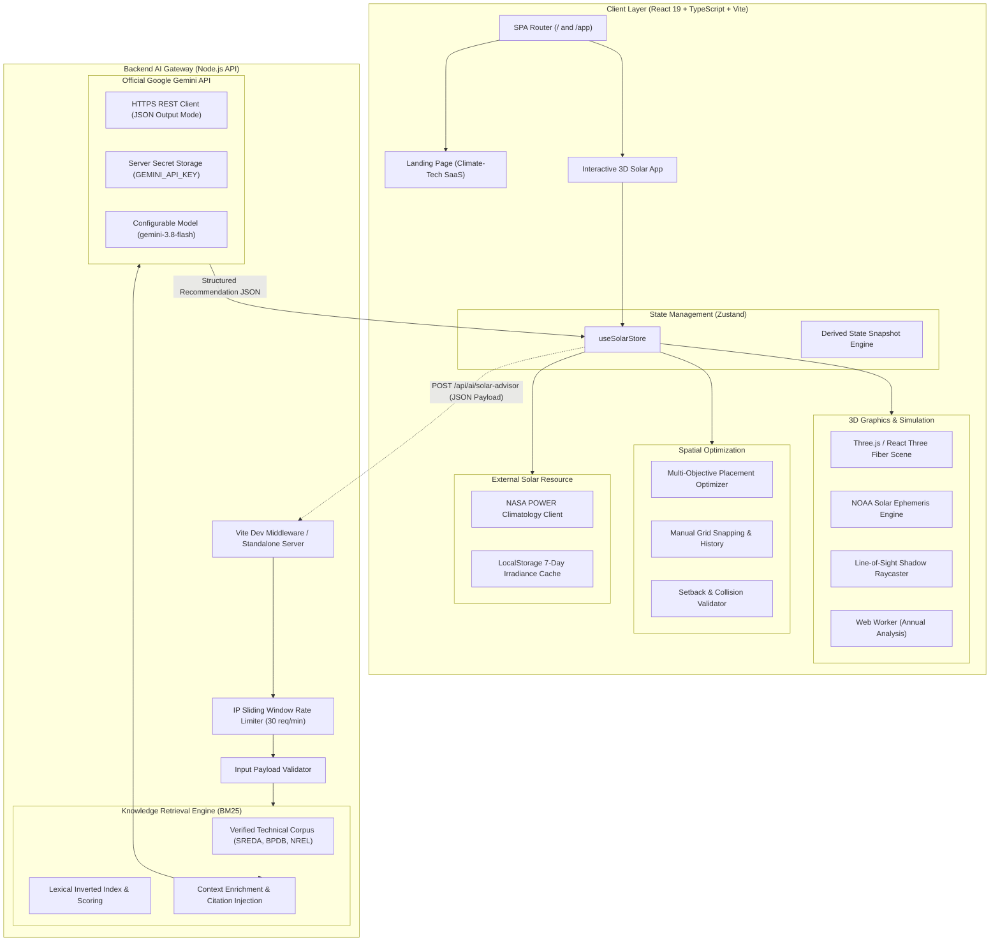

# RoofRay V3 — System Architecture

**Track:** International AI Builders Congress 2026 — Idea to Unicorn  
**Architecture Classification:** Decoupled Client-Side Physical Simulation Engine with Secure Server-Side AI Knowledge Gateway  

---

## 1. High-Level Architecture Diagram

---

## 2. Component Subsystems

### A. Client-Side Presentation & Router Layer
- **Vite & React 19:** Fast modular bundler with zero-dependency history router supporting `/` and `/app` routes with deep query parameter restoration (`?city=...&tour=true`).
- **Tailwind CSS & Lucide Icons:** Clean climate-tech SaaS design tokens with dark navy (`slate-950`), amber solar accents, and emerald eco accents.
- **Zustand Central Store:** Unified reactive state store (`useSolarStore.ts`) managing building geometries, ephemeris state, manual panel coordinates, undo/redo history stacks, and derived economic outputs.

### B. 3D Astronomical & Physical Simulation Engine
- **NOAA Solar Position Engine (`src/simulation/sunPosition.ts`):** Deterministic astronomical algorithms calculating Julian Century, Geometric Mean Anomaly, Solar Declination, Equation of Time, and True Elevation/Azimuth angles.
- **Live Shadow Raycasting (`src/simulation/shadowRaycaster.ts`):** Casts shadow vectors from each 0.8m roof cell center towards the sun vector. Intersects with 3D bounding boxes of all buildings and rooftop utility obstacles.
- **Web Worker Annual Analysis (`src/simulation/analysis.worker.ts`):** Spawns dedicated background worker evaluating 291 annual solar samples across 396 roof cells in ~110 ms, avoiding any main-thread UI jank.

### C. Spatial Optimization Engine (`src/optimization/`)
- **Boundary & Collision Detection:** Ensures all modules strictly respect 0.8m perimeter firefighter buffer and 0.5m clearance around rooftop obstacles.
- **Heuristic Layout Ranking:** Ranks candidate module placement coordinates by annual solar insolation yield, fitting maximum capacity for a chosen optimization mode.

### D. Weather-Informed Climatology Provider (`src/services/`)
- Communicates directly with the NASA Langley Research Center POWER API (`https://power.larc.nasa.gov`).
- Queries multi-year satellite observations for horizontal irradiance (GHI) and compares all-sky vs. clear-sky potential.
- Implements 7-day client-side caching to minimize redundant API calls.

### E. Backend AI Service & Security Gateway (`server/` and `src/server/`)
- **API Endpoints:**
  - `POST /api/ai/solar-advisor`: Accepts structured calculation snapshot, validates payload, queries lexical RAG index, and synthesizes grounded advice.
  - `GET /api/ai/health`: Provides uptime, active model, and API configuration status.
- **Secret Isolation:** `GEMINI_API_KEY` is loaded strictly on the Node.js side via `process.env`. Frontend code never receives or stores the API key.
- **Dual Runtime Support:** Operates seamlessly via Vite development server middleware during `npm run dev` and via standalone `server/server.ts` in production containers.
